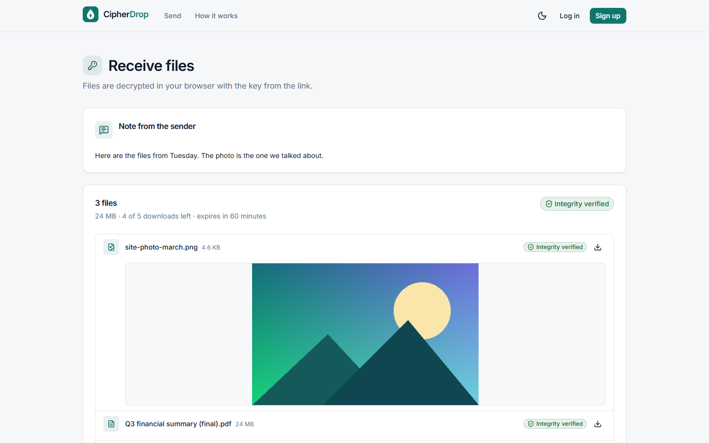
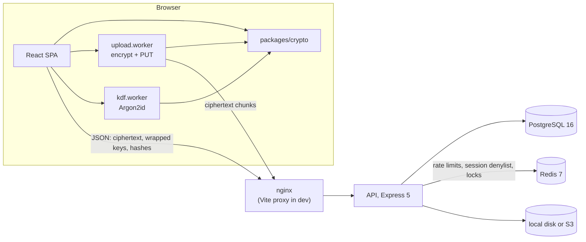

# CipherDrop

Zero-knowledge, end-to-end encrypted file sharing: files are encrypted in the browser before upload, and the
server stores only ciphertext it has no key for.



## What it does

- **Send** up to 20 files per drop (100 MiB of ciphertext anonymously, 2 GiB with an account). The browser encrypts them
  with AES-256-GCM in 4 MiB chunks and uploads only ciphertext. The share link carries the key after `#`, which browsers never send to a server.
- **Password links** as an alternative: the link has no key, and the drop key is unwrapped with a key derived
  from the password through Argon2id.
- **Burn after reading and expiry**: a download limit of 1 (burn after reading) to 10 anonymously or up to 100
  with an account, and expiry from 1 hour to 3 days anonymously or up to 30 days with an account.
- **Receive**: names, sizes and the sender's note are decrypted in the browser; every chunk is authenticated, and
  a modified file is blocked before it is saved. Image and text previews.
- **Zero-knowledge accounts**: the password never leaves the browser. A dashboard lists your drops with decrypted
  names on any device; recovery key, TOTP two-factor login with backup codes, session list with revocation,
  password change, account deletion, and an activity log ("Your drop was downloaded", with the IP prefix such as
  203.0.113.0/24 and the browser).
- **Admin console**: statistics with a 14-day uploads chart, an abuse-report queue (disable or dismiss, and review
  a drop when the reporter chose to share its key), user role and quota edits.
- **Operations**: local-disk or S3-compatible storage, Prometheus metrics, health and readiness checks, an
  OpenAPI document with Swagger UI, and a production Docker Compose stack behind nginx.

## Engineering highlights

These are the problems that took the most work, and the parts an interviewer is likely to ask about.

1. **Streaming authenticated encryption for large files.** One AES-GCM message cannot hold a multi-GB file in a
   browser, and authenticating chunks independently would allow reordering or truncation. CipherDrop uses the
   STREAM construction (Hoang, Reyhanitabar, Rogaway and Vizár, 2015): the nonce of each 4 MiB chunk holds its
   index and a last-chunk flag, and every file has its own HKDF-derived key, so nonces never repeat. Unit tests
   flip bits, swap chunks, drop the final chunk and replay a final chunk as non-final; all are rejected. The
   crypto package encrypts at 846 MiB/s and decrypts at 727 MiB/s in Node on the benchmark laptop.
2. **A key hierarchy that makes accounts zero-knowledge.** Argon2id (64 MiB, t=3) runs in a Web Worker; HKDF
   splits the result into an auth key, which the server hashes again with Argon2id, and an encryption key that
   wraps a random account key. The account key wraps every drop key the user sends while signed in, and a 160-bit recovery key
   wraps it a second time. A password change re-wraps one key; no file is re-encrypted. The client refuses KDF
   parameters below 19 MiB / t=2, so a malicious server cannot downgrade them.
3. **Burn after reading under concurrency.** Consuming a download is one conditional SQL `UPDATE`; with 10
   concurrent opens on a 1-download link, exactly one succeeds (integration test). Download grants let a started
   download finish after the drop becomes EXHAUSTED or EXPIRED, and blobs are purged through a single path that
   releases the storage quota exactly once.
4. **Uploads that race with deletes.** Each chunk PUT writes a new blob version without holding a database
   connection, then a short `FOR SHARE` transaction re-checks the drop and points the chunk row at that version.
   Delete, admin disable and `complete` cannot interleave with a half-finished write (review findings C-04 and
   C-R2-01; `apps/api/src/modules/drops/drops.races.test.ts` has 11 race tests).
5. **Abuse resistance on the transfer path.** Per-token and per-IP rate limits (an IP limiter runs first so random
   tokens cannot dodge it), in-flight caps per token, per client and per process with `429` and `Retry-After`, a
   minimum body rate of 4,096 bytes/s against slow-drip uploads, and an idle timeout on downloads so slow readers
   cannot exhaust the 256-socket S3 pool.
6. **Proving that no plaintext reaches the server.** The Playwright suite runs the production build under the
   production CSP and records every API request of every browser context, the upload worker's included. A leak
   guard fails the run if a test file
   name (raw, URL-encoded, JSON-escaped, base64 or base64url), plaintext bytes or key material appear in any URL,
   header or body. A tamper test flips one byte of a chunk in flight and expects the UI to block the save.
7. **Measuring honestly.** In headless Chromium the app uploads at 13.0 MiB/s (median of 9 runs), while the same
   API takes 82.3 MiB/s from Node. A control with no CipherDrop code shows that headless Chromium itself uploads
   only 17.7 to 20.5 MiB/s on this machine, so most of the gap is the browser's own upload path, not the server; the
   app reaches roughly 70 to 85 % of that ceiling ([BENCHMARKS.md](docs/BENCHMARKS.md) section 5).

## Architecture



The browser does all cryptography with WebCrypto and `hash-wasm`, through one isomorphic package
(`packages/crypto`) that the Node tests, the seed script and the benchmarks also use. Encryption and uploads run
in a module Worker, Argon2id in another. The API validates every request with zod schemas shared with the SPA,
enforces sizes, quotas, download limits, expiry and rate limits, and stores opaque blobs: it never parses
ciphertext. Postgres holds accounts, drops, sessions and the audit log; Redis holds rate-limit counters, the
revoked-session denylist and the cleanup lock; a cleanup job expires drops, purges blobs and prunes old records.

[docs/ARCHITECTURE.md](docs/ARCHITECTURE.md) has the request path, the upload and download pipelines, the key
hierarchy, the drop lifecycle and the session flow as diagrams, plus the design decisions and their reasons.

## Tech stack

| Area                 | Choice                                                                                                                                              |
| -------------------- | --------------------------------------------------------------------------------------------------------------------------------------------------- |
| Language and tooling | TypeScript 5.9 (strict, ESM), npm workspaces, Node 22, ESLint 9, Prettier 3                                                                         |
| Cryptography         | WebCrypto (AES-256-GCM, HKDF-SHA-256, SHA-256), `hash-wasm` Argon2id in the browser, `@node-rs/argon2` on the server                                |
| API                  | Express 5, Prisma 6, PostgreSQL 16, Redis 7 (ioredis), zod 3, OpenAPI via `zod-to-openapi`, pino, helmet, `otpauth`, AWS SDK v3 for S3, prom-client |
| Web                  | React 19, Vite 7, Tailwind CSS 4, React Router 7, TanStack Query 5, Zustand 5                                                                       |
| Tests                | Vitest 3, Supertest, Testing Library with jsdom, Playwright (Chromium)                                                                              |
| Infrastructure       | Docker Compose (Postgres, Redis, MinIO), nginx, optional Caddy for TLS, a GitHub Actions workflow                                                   |

## Quick start

Prerequisites: Node 22.12 or later with npm 10, and Docker with Compose v2. On Node 22.12, `npm ci` warns that
`eslint-visitor-keys` (an ESLint dependency) wants 22.13; the warning is harmless, and Node 22.13 or later avoids it.

```bash
npm ci
cp apps/api/.env.example apps/api/.env      # local dev values only
cp apps/web/.env.example apps/web/.env      # enables "Use demo account" on the login page
docker compose up -d --wait                 # Postgres :55433, Redis :56380, MinIO :59000 (console :59001)
npm run db:deploy                           # apply the Prisma migrations
npm run db:seed                             # demo accounts and drops; safe to re-run
npm run dev                                 # web http://localhost:5174, API http://localhost:4100
```

`--wait` returns once the containers are healthy, so the migrations do not race a Postgres that is still
starting. `npm run dev` needs ports 5174 and 4100 free (Vite runs with `strictPort`). To use other ports, change
`API_PORT` and `WEB_ORIGIN` in `apps/api/.env`, set `API_PROXY_TARGET` in `apps/web/.env`, and start the two
servers separately (`npm run dev -w @cipherdrop/api` and `npm run dev -w @cipherdrop/web -- --port <port>`).

The seed creates two accounts (dev data only) and prints the share links of its drops:

| Account                  | Password                                                               | Role  |
| ------------------------ | ---------------------------------------------------------------------- | ----- |
| `demo@cipherdrop.local`  | `SEED_DEMO_PASSWORD`; `.env.example` sets `demo-cipherdrop-dev-2026`   | user  |
| `admin@cipherdrop.local` | `SEED_ADMIN_PASSWORD`; `.env.example` sets `admin-cipherdrop-dev-2026` | admin |

The demo account owns four drops: welcome.txt and sample.csv (10 downloads, 7 days), a password-protected
diagram.png (password `correct horse battery staple`, 5 downloads, 3 days), a one-download burn-note.txt (1 day)
and an expired old-report.pdf (the dashboard shows it under **Expired** or **All**; the default tab is **Active**).
One open abuse report on diagram.png is waiting in the admin queue. Expiry counts from the first seed run;
re-running the seed reprints the links but does not renew the drops. On the login page, **Use demo account** fills
in the form; press **Log in** to sign in.

[docs/DEMO.md](docs/DEMO.md) is a two-minute demo script built on this data. The API's Swagger UI is at
http://localhost:5174/api/docs.

## Running the tests

| Command                                                     | What it runs                                                                                                                                         | Current result                                                                                 |
| ----------------------------------------------------------- | ---------------------------------------------------------------------------------------------------------------------------------------------------- | ---------------------------------------------------------------------------------------------- |
| `npm test`                                                  | unit and integration tests of all four workspaces; the API tests need the Compose Postgres and Redis and create their own `cipherdrop_test` database | 735 passed: crypto 147, shared 15, API 266 (+10 S3 tests skipped without `S3_TEST=1`), web 307 |
| `npm run test:s3`                                           | the storage contract suite against MinIO (`S3_TEST=1`)                                                                                               | 27 passed                                                                                      |
| `npm run e2e`                                               | Playwright against `vite build` + `vite preview` (production CSP on) and a real API on a separate `cipherdrop_e2e` database                          | 26 passed                                                                                      |
| `npm run typecheck`, `npm run lint`, `npm run format:check` | `tsc` for every workspace, ESLint, Prettier                                                                                                          | clean                                                                                          |

Run `npm run e2e:install -w @cipherdrop/web` once to install Playwright's Chromium. Counts were taken on
2026-11-12 on the development laptop.

What the tests cover, in brief: `packages/crypto` tests each security property of the construction, Argon2id
known-answer vectors from the reference implementation, and a re-implementation of the spec with `node:crypto`
that pins a golden vector. The API tests run against real Postgres and Redis (concurrency races, rate limits,
session reuse detection, cleanup, retention, the OpenAPI route walk). The e2e suite covers send and receive,
password drops, burn after reading, tampering, an upload that survives two injected 503 errors, resume after a
reload, accounts with TOTP and recovery, sessions, the dashboard and the admin console, with the leak guard on
every test.

## Project layout

```
apps/
  api/            Express 5 API
    prisma/       schema, migrations, seed
    src/          app, config, lib, middleware, modules (auth, me, drops, admin, audit, health),
                  storage (local, s3), jobs (cleanup), openapi
    scripts/      smoke test and upload benchmark
  web/            React SPA
    src/          features (send, receive, auth, account, dashboard, settings, admin, howitworks),
                  crypto (uploader, downloader, sinks, kdfClient), workers, stores, components, lib
    e2e/          Playwright specs and the leak guard
    bench/        browser benchmarks
    deploy-checks/  nginx header test and production smoke test
packages/
  crypto/         the cryptographic construction, isomorphic (browser and Node)
  shared/         zod schemas and constants shared by the API and the SPA
deploy/           nginx.conf, Caddyfile
docs/             design, architecture, API, security, deployment, benchmarks, demo, review record, screenshots
docker-compose.yml        dev infrastructure
docker-compose.prod.yml   production stack
```

## Security notes and trade-offs

- The server cannot read files, names or notes, but it **can see metadata**: file sizes (plus 16 bytes per chunk),
  file counts, timestamps, download counts, IP prefixes and the account email.
- **Browser cryptography trusts the JavaScript the server delivers.** A malicious server could serve code that
  leaks keys. The CSP allows no third-party origins, and nothing is loaded from a CDN, but there is no
  Subresource Integrity or reproducible-build check in v1.
- **A link with the key is a bearer secret**: anyone holding it can download. Password mode keeps the key out of
  the link.
- **Burn after reading is enforced by the server**, not by cryptography: an honest server deletes the blobs, a
  compromised one could keep them.
- **Losing both the password and the recovery key loses the account's data.** Nobody can reset it.
- A stolen database allows offline password guessing at the cost of one Argon2id derivation per guess.

[docs/SECURITY.md](docs/SECURITY.md) has the full threat model (server, network attacker, malicious recipient,
stolen database, XSS), the cryptographic design in brief, the metadata list, account and session security, and
the accepted open points from the review. The normative specification is [docs/DESIGN.md](docs/DESIGN.md),
section 7.

## Deployment

`docker-compose.prod.yml` runs Postgres, Redis, the API image (runs as a non-root user with a read-only root
filesystem and applies migrations on start), nginx serving the SPA with the security headers, and optionally
MinIO and Caddy for automatic HTTPS. The API refuses to start in production without explicit database, Redis,
origin and proxy settings, secure cookies and real secrets. [docs/DEPLOYMENT.md](docs/DEPLOYMENT.md) covers the
single-host stack, S3-compatible storage, a split deployment and multi-instance limits.

## Benchmarks

Measured on 2026-11-12 on a shared 4-core laptop (i7-1195G7, Windows 11): medians with the minimum and maximum
in parentheses, rates in MiB/s of plaintext. The crypto rows encrypt 64 MiB per pass; the API and browser rows
move a 96 MiB random file (9 runs per transfer figure).

| Path                                       | Operation                                             | Result                                    |
| ------------------------------------------ | ----------------------------------------------------- | ----------------------------------------- |
| Node, `packages/crypto`                    | STREAM encrypt / decrypt                              | 846 (773 to 856) / 727 (710 to 728) MiB/s |
| Node, `packages/crypto`                    | Argon2id at the default parameters (64 MiB, t=3, p=1) | 328 ms (277 to 341)                       |
| Node client to the API, 3 chunks in flight | encrypt + SHA-256 + upload                            | 82.3 (67.7 to 89.8) MiB/s                 |
| Node client to the API, 3 chunks in flight | download + decrypt                                    | 121.6 (96.5 to 141.0) MiB/s               |
| Headless Chromium, production build        | encrypt + upload                                      | 13.0 (4.8 to 15.3) MiB/s                  |
| Headless Chromium, production build        | download + decrypt                                    | 66.2 (32.0 to 73.8) MiB/s                 |
| Headless Chromium, production build        | Argon2id in the Worker, cold / warm                   | 291 / 253 ms                              |

Two further browser runs while another session saturated the CPU were 3 to 5 times slower and are excluded from
the table; [docs/BENCHMARKS.md](docs/BENCHMARKS.md) has the method, the load readings, the Chromium upload control and the
caveats.

## Code review record

[docs/review/2026-11-11-review.md](docs/review/2026-11-11-review.md) records a structured review of the
finished build: six review lenses (cryptography, accounts and API security, drop lifecycle and storage,
frontend, operations, spec conformance) produced 55 raw findings. One was rejected at triage, merging duplicates
left 45, and verification refuted 11: **34 were confirmed (20 API, 14 web) and all 34 were fixed**, each with a
regression test that failed before the fix (one, C-30, was checked by hand because the entry point runs on
import). Three adversarial reviews of the fixes followed, with 14, 10 and 6 further items; all 30 were fixed with
a failing regression test first (one, C-R3-10, only needed the missing test). The open points that were accepted rather than fixed are listed in the record and in
[docs/SECURITY.md](docs/SECURITY.md#7-accepted-open-points).

## License

MIT. See [LICENSE](LICENSE).
