# CipherDrop

[](https://github.com/exotic-Siddharth/cipherdrop/actions/workflows/ci.yml)

Zero-knowledge, end-to-end encrypted file sharing: files are encrypted in the browser before upload, and the
server stores only ciphertext it has no key for.

**Live demo:** <https://cipherdrop.20-205-104-24.sslip.io> (a small public instance with storage caps).


[Screenshots](#screenshots) of every view are further down; [docs/DEMO.md](docs/DEMO.md) is the script, and
`npm run media -w @cipherdrop/web` records the clip and regenerates the screenshots from the running app.

## What it does

- **Send** up to 20 files per drop (100 MiB of ciphertext anonymously, 2 GiB with an account). The browser encrypts them
  with AES-256-GCM in 4 MiB chunks and uploads only ciphertext. The share link carries the key after `#`, which browsers never send to a server.
  Anonymous senders get 1 GiB per 24 hours per IPv4 address or IPv6 /48, and all anonymous drops together at most
  10 GiB (both configurable). A drop with a file over 256 MiB can only be received in a browser with the File System
  Access API, such as desktop Chrome or Edge ([Browser support](#browser-support)).
- **Password links** as an alternative: the link has no key, and the drop key is unwrapped with a key derived
  from the password through Argon2id.
- **Burn after reading and expiry**: a download limit of 1 (burn after reading) to 10 anonymously or up to 100
  with an account, and expiry from 1 hour to 3 days anonymously or up to 30 days with an account.
- **Receive**: names, sizes and the sender's note are decrypted in the browser; every chunk is authenticated, and
  a modified file is blocked before it is saved. "Integrity verified" means the bytes are exactly what was encrypted
  with the link's key, not who sent them or that they are safe, and the page says so. Image and text previews. The
  page takes the key out of the address bar once it has read it (a reload of the same tab still works) and offers an
  explicit **Copy link**. Active file types (HTML, SVG, XML, scripts, PDF and others) are saved as
  `application/octet-stream`.
- **Zero-knowledge accounts**: the password never leaves the browser. A dashboard lists your drops with decrypted
  names on any device; recovery key, TOTP two-factor login with backup codes, session list with revocation,
  password change, account deletion, and an activity log ("Your drop was downloaded", with the IP prefix such as
  203.0.113.0/24 and the browser). Sensitive actions ask for the password again (and the 2FA code when it is on), and
  a session ends 30 days after sign-in (by default) however active it is.
- **Admin console** (admins need two-step verification): statistics with a 14-day uploads chart, an abuse-report
  queue (disable or dismiss, and review a drop when the reporter chose to share its key), user role and quota edits.
- **Limits for a public instance**: new accounts store up to 256 MiB for their first 7 days, then 5 GiB (an admin can
  change it); operators can switch off anonymous uploads or sign-ups, cap total storage, and keep a free-disk floor;
  the send and register pages explain a closed door or a full server.
- **Operations**: local-disk or S3-compatible storage, Prometheus metrics, health and readiness checks, an OpenAPI
  document (with Swagger UI in development only), `/.well-known/security.txt`, and a production Docker Compose stack
  behind nginx.

## Screenshots

Click a picture for the full size (2x). All of them come from `npm run media -w @cipherdrop/web` against the real
build and API ([docs/DEMO.md](docs/DEMO.md#recording-the-demo-and-the-screenshots)); most have a light and a dark
version in [docs/screenshots](docs/screenshots).

<table>
  <tr>
    <td valign="top"><a href="docs/screenshots/send-progress-dark.png">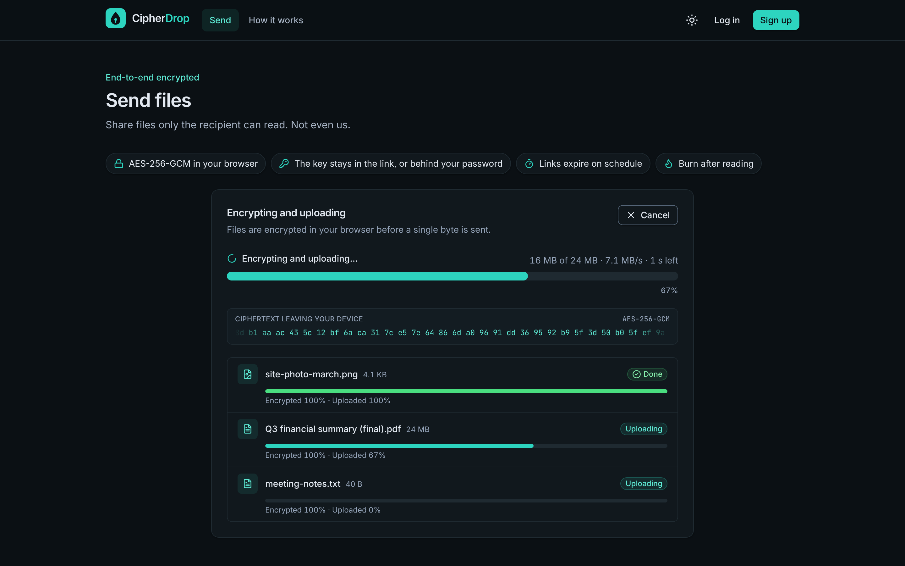</a><br>Encrypt and upload: the strip is the real ciphertext</td>
    <td valign="top"><a href="docs/screenshots/send-success-light.png">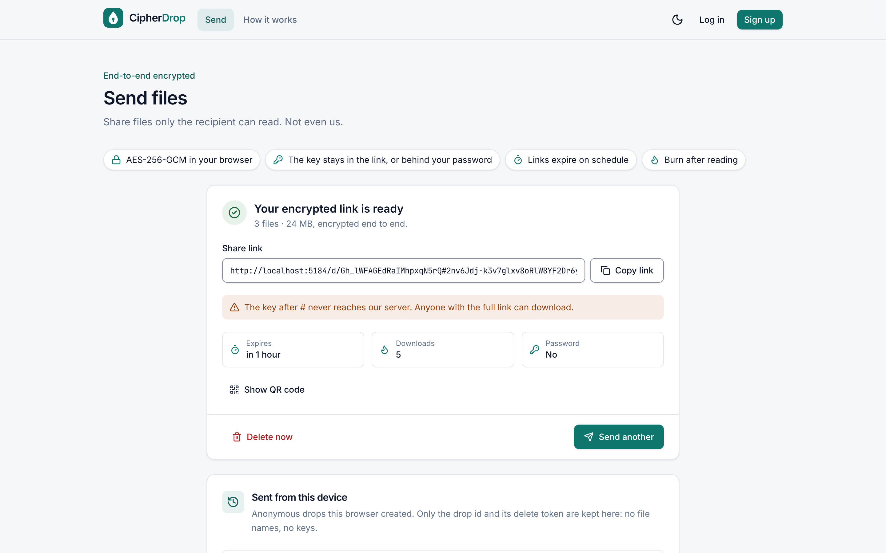</a><br>The link: the key after <code>#</code> stays in the browser</td>
    <td valign="top"><a href="docs/screenshots/receive-light.png">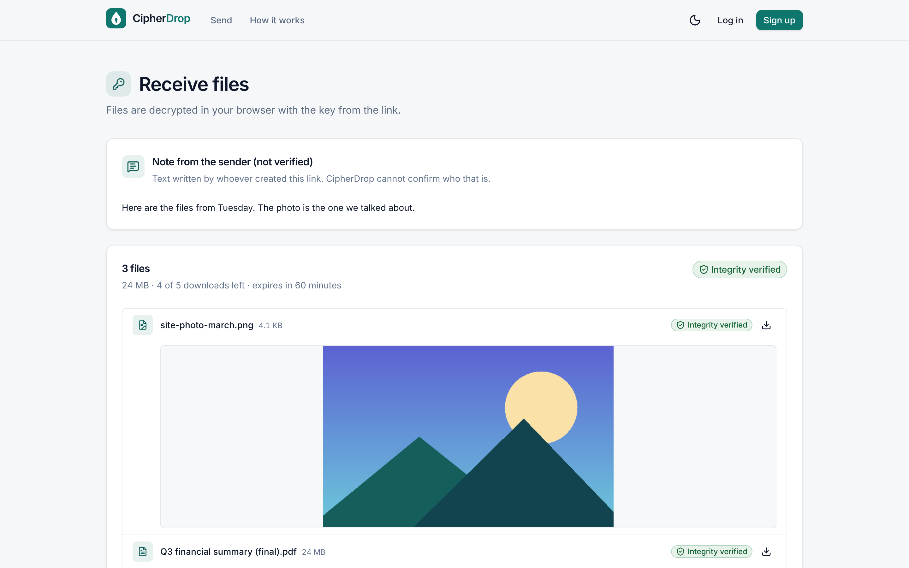</a><br>Decrypted in the browser, every file verified</td>
  </tr>
  <tr>
    <td valign="top"><a href="docs/screenshots/receive-tamper-blocked-light.png">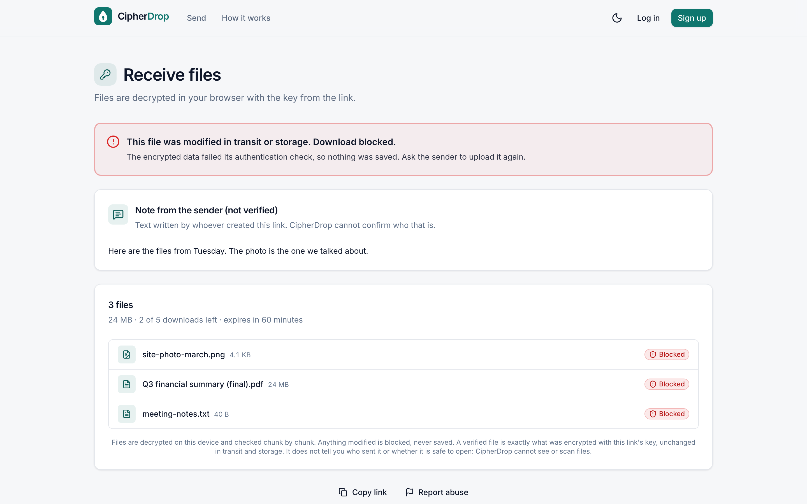</a><br>One byte changed in transit: blocked, nothing saved</td>
    <td valign="top"><a href="docs/screenshots/receive-password-light.png">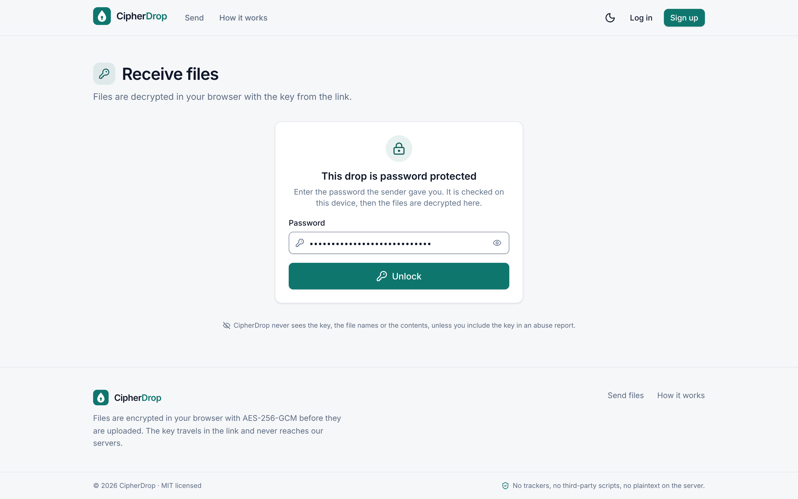</a><br>A password link carries no key</td>
    <td valign="top"><a href="docs/screenshots/receive-burned-light.png">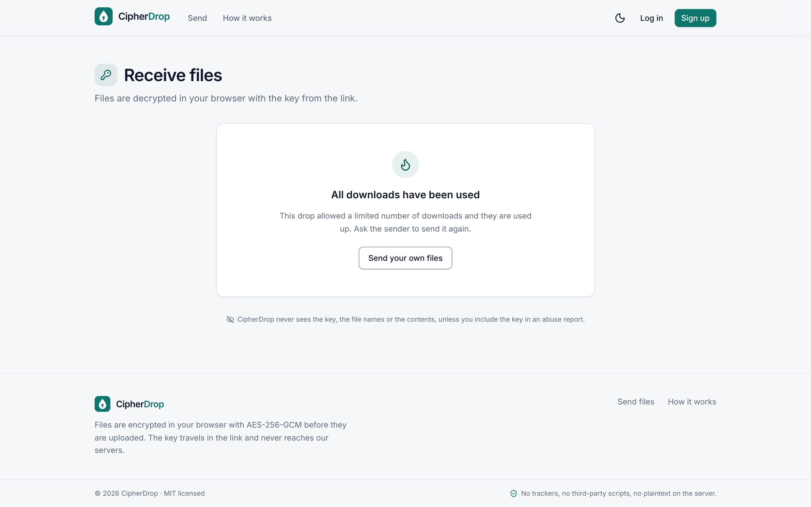</a><br>Burn after reading: the link is used up</td>
  </tr>
  <tr>
    <td valign="top"><a href="docs/screenshots/dashboard-light.png">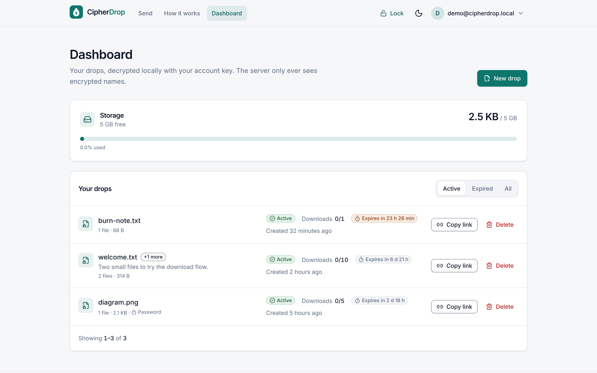</a><br>Dashboard: names decrypted with the account key</td>
    <td valign="top"><a href="docs/screenshots/register-recovery-key-light.png">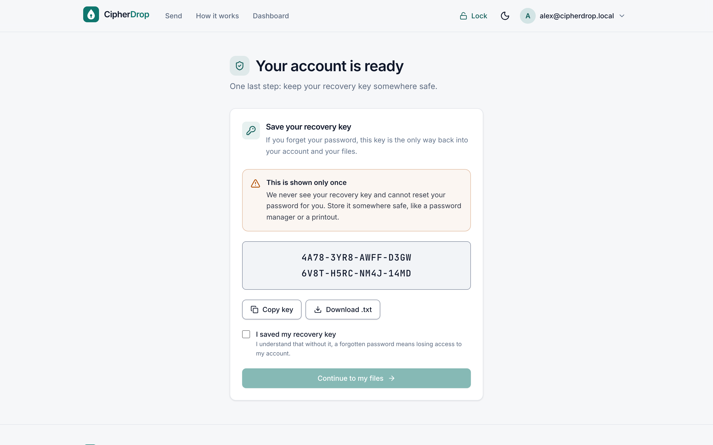</a><br>The recovery key, shown once at sign-up</td>
    <td valign="top"><a href="docs/screenshots/totp-setup-light.png">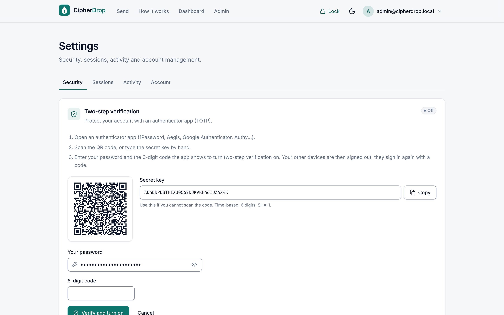</a><br>Two-step verification setup</td>
  </tr>
  <tr>
    <td valign="top"><a href="docs/screenshots/admin-dark.png">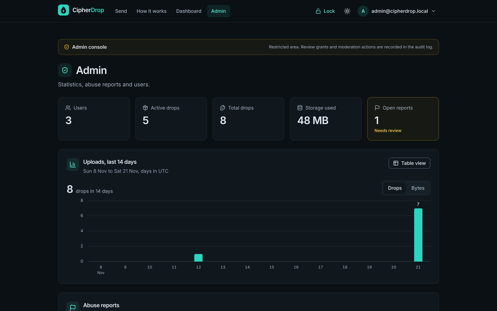</a><br>Admin console (admins need two-step verification)</td>
    <td valign="top"><a href="docs/screenshots/login-2fa-light.png">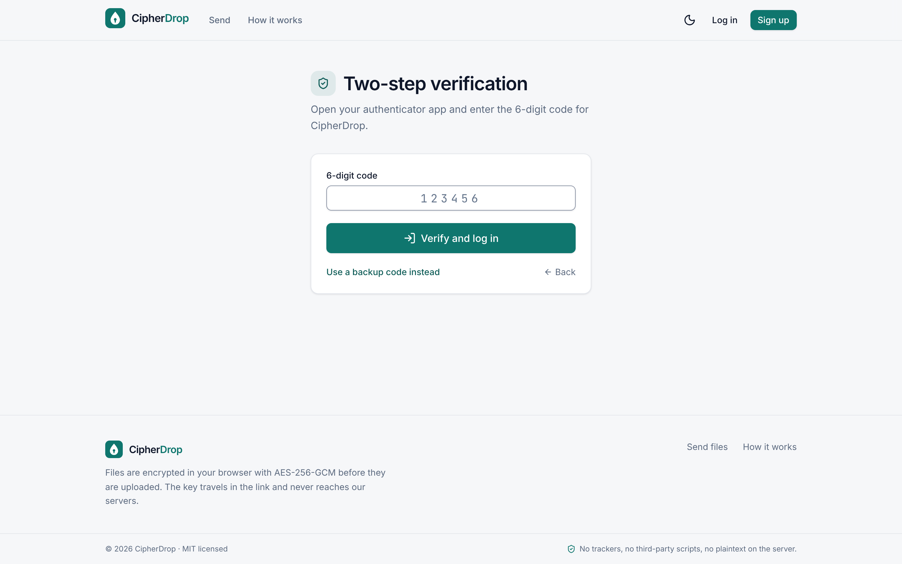</a><br>Sign-in with a second factor</td>
    <td valign="top"><a href="docs/screenshots/how-it-works-dark.png">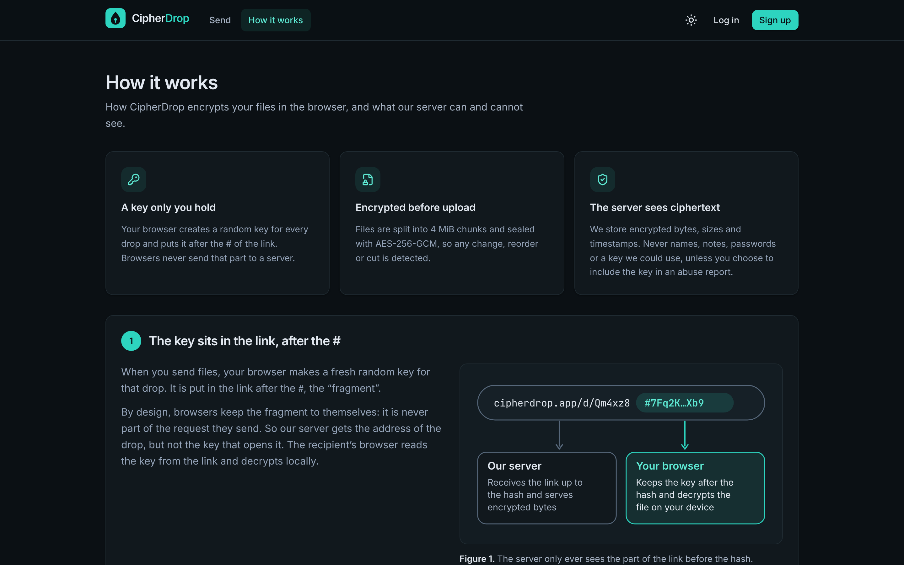</a><br>How it works, in the app</td>
  </tr>
</table>

Phone layout (390 px): [send](docs/screenshots/send-mobile-light.png), [receive](docs/screenshots/receive-mobile-dark.png),
[blocked after tampering](docs/screenshots/receive-tamper-blocked-mobile-light.png) and
[dashboard](docs/screenshots/dashboard-mobile-dark.png). [hero.png](docs/screenshots/hero.png) puts the sender and
the recipient side by side: 2560x1280 (1280x640 CSS pixels at 2x; the 2:1 ratio GitHub recommends for a social
preview, 426 KB, under its 1 MB limit).

## Engineering highlights

These are the problems that took the most work, and the parts an interviewer is likely to ask about.

1. **Streaming authenticated encryption for large files.** One AES-GCM message cannot hold a multi-GB file in a
   browser, and authenticating chunks independently would allow reordering or truncation. CipherDrop uses the
   STREAM construction (Hoang, Reyhanitabar, Rogaway and Vizár, 2015): the nonce of each 4 MiB chunk holds its
   index and a last-chunk flag, and every file has its own HKDF-derived key, so nonces never repeat. Unit tests
   flip bits, swap chunks, drop the final chunk and replay a final chunk as non-final; all are rejected. The
   crypto package encrypts at 846 MiB/s and decrypts at 727 MiB/s in Node on the benchmark laptop.
2. **A key hierarchy that makes accounts zero-knowledge.** Argon2id (64 MiB, t=3) runs in a Web Worker; HKDF
   splits the result into an auth key, which the server hashes again with Argon2id, and an encryption key that
   wraps a random account key. The account key wraps every drop key the user sends while signed in, and a 160-bit recovery key
   wraps it a second time. A password change re-wraps one key; no file is re-encrypted. The client refuses KDF
   parameters below 19 MiB / t=2, so a malicious server cannot downgrade them.
3. **Burn after reading under concurrency.** Consuming a download is one conditional SQL `UPDATE`; with 10
   concurrent opens on a 1-download link, exactly one succeeds (integration test). Download grants let a started
   download finish after the drop becomes EXHAUSTED or EXPIRED, and blobs are purged through a single path that
   releases the storage quota exactly once.
4. **Uploads that race with deletes.** Each chunk PUT writes a new blob version without holding a database
   connection, then a short `FOR SHARE` transaction re-checks the drop and points the chunk row at that version.
   Delete, admin disable and `complete` cannot interleave with a half-finished write (review findings C-04 and
   C-R2-01; `apps/api/src/modules/drops/drops.races.test.ts` has 11 race tests).
5. **Abuse resistance.** The server cannot scan ciphertext, so hosting abuse is bounded by cost and volume:
   anonymous creates and sign-ups are limited per IPv4 address or IPv6 /48 (not /64, of which a /48 holds 65,536), a
   rolling byte budget per anonymous client lives in Redis, new accounts start on a probation quota, and a global
   storage cap and a free-disk floor refuse new drops before the disk fills ([SECURITY.md](docs/SECURITY.md) section
   2.7, with the residual risks). Logins are bounded too: at most 2 server-side Argon2id hashes run at once per
   process, 32 wait, and the rest get `429` with `Retry-After: 1`, which counts as no failed login. On the transfer
   path: per-token and per-IP rate limits (an IP limiter runs first so random tokens cannot dodge it), in-flight caps
   per token, per client and per process with `429` and `Retry-After`, a minimum body rate of 4,096 bytes/s against
   slow-drip uploads, and an idle timeout on downloads so slow readers cannot exhaust the 256-socket S3 pool. The
   bundled nginx streams chunk PUTs and GETs instead of buffering them, so these defences act on the real client, and
   it caps in-flight `/api` requests at 64 per client (16 PUT + 32 GET API shares + 16), keyed like the API's
   in-flight shares (IPv4 address or IPv6 /48). The production smoke test checks this with raw-socket slow clients. Behind the bundled Caddy, nginx trusts `X-Forwarded-For` only from
   Caddy's fixed address, so the cap sees the real client.
6. **Proving that no plaintext reaches the server.** The Playwright suite runs the production build under the
   production CSP and records every request of every browser context: navigations, assets, worker scripts, the
   upload worker's chunk PUTs and the API calls, with every header the browser sent (Cookie included). A leak guard
   fails the run if a request goes to another origin, or if a test file name (raw, URL-encoded the ways scripts, forms
   and the browser's URL parser do it, JSON-escaped, base64 or base64url), plaintext bytes (raw, base64, base64url or hex) or a key (its link text, or
   its bytes raw, as base64, base64url or hex) appears in any URL, header or body, and on any CSP or Trusted Types
   message in the console; 19 self-tests check that it catches each case. A subset of the suite also runs in
   Firefox, WebKit and two emulated phones. On the server side, log tests run whole flows, forced 500s included, and
   fail if a token, key, manifest or file byte reaches the API's logs. A tamper test flips one byte of a chunk in flight and expects the
   UI to block the save.
7. **Measuring honestly.** In headless Chromium the app uploads at 13.0 MiB/s (median of 9 runs), while the same
   API takes 82.3 MiB/s from Node. A control with no CipherDrop code shows that headless Chromium itself uploads
   only 17.7 to 20.5 MiB/s on this machine, so most of the gap is the browser's own upload path, not the server; the
   app reaches roughly 70 to 85 % of that ceiling ([BENCHMARKS.md](docs/BENCHMARKS.md) section 5).

## Architecture

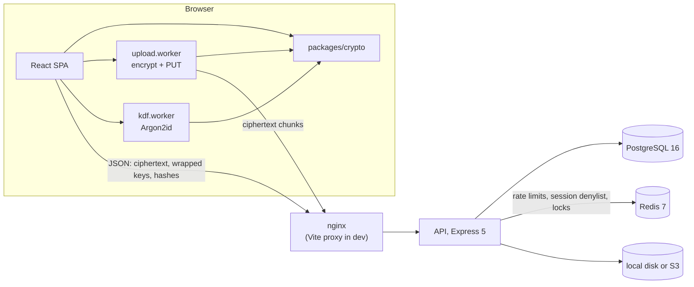

The browser does all cryptography with WebCrypto and `hash-wasm`, through one isomorphic package
(`packages/crypto`) that the Node tests, the seed script and the benchmarks also use. Encryption and uploads run
in a module Worker, Argon2id in another. The API validates every request with zod schemas shared with the SPA,
enforces sizes, quotas, download limits, expiry and rate limits, and stores opaque blobs: it never parses
ciphertext. Postgres holds accounts, drops, sessions and the audit log; Redis holds rate-limit counters, the
revoked-session denylist and the cleanup lock; a cleanup job expires drops, purges blobs and prunes old records.

[docs/ARCHITECTURE.md](docs/ARCHITECTURE.md) has the request path, the upload and download pipelines, the key
hierarchy, the drop lifecycle and the session flow as diagrams, plus the design decisions and their reasons.

## Tech stack

| Area                 | Choice                                                                                                                                                            |
| -------------------- | ----------------------------------------------------------------------------------------------------------------------------------------------------------------- |
| Language and tooling | TypeScript 5.9 (strict, ESM), npm workspaces, Node 22, ESLint 9, Prettier 3                                                                                       |
| Cryptography         | WebCrypto (AES-256-GCM, HKDF-SHA-256, SHA-256), `hash-wasm` Argon2id in the browser, `@node-rs/argon2` on the server                                              |
| API                  | Express 5, Prisma 6, PostgreSQL 16, Redis 7 (ioredis), zod 3, OpenAPI via `zod-to-openapi`, pino, helmet, `otpauth`, AWS SDK v3 for S3, prom-client               |
| Web                  | React 19, Vite 7, Tailwind CSS 4, React Router 7, TanStack Query 5, Zustand 5                                                                                     |
| Tests                | Vitest 3, Supertest, Testing Library with jsdom, Playwright (Chromium for every spec; Firefox, WebKit and two emulated phones for the @cross subset)              |
| Infrastructure       | Docker Compose (Postgres, Redis, MinIO), nginx, optional Caddy for TLS, GitHub Actions (CI, a dependency audit gate, CodeQL, gitleaks, zizmor, Trivy), Dependabot |

## Quick start

Prerequisites: Node 22.12 or later with npm 10, and Docker with Compose v2. On Node 22.12, `npm ci` warns that
`eslint-visitor-keys` (an ESLint dependency) wants 22.13; the warning is harmless, and Node 22.13 or later avoids it.

```bash
npm ci
cp apps/api/.env.example apps/api/.env      # local dev values only
cp apps/web/.env.example apps/web/.env      # enables "Use demo account" on the login page
docker compose up -d --wait                 # Postgres :55433, Redis :56380, MinIO :59000 (console :59001)
npm run db:deploy                           # apply the Prisma migrations
npm run db:seed                             # demo accounts and drops; safe to re-run
npm run dev                                 # web http://localhost:5174, API http://localhost:4100
```

`--wait` returns once the containers are healthy, so the migrations do not race a Postgres that is still
starting. `npm run dev` needs ports 5174 and 4100 free (Vite runs with `strictPort`). To use other ports, change
`API_PORT` and `WEB_ORIGIN` in `apps/api/.env`, set `API_PROXY_TARGET` in `apps/web/.env`, and start the two
servers separately (`npm run dev -w @cipherdrop/api` and `npm run dev -w @cipherdrop/web -- --port <port>`).

The seed creates two accounts (dev data only) and prints the share links of its drops. The admin has no two-step
verification, so the console asks it to turn it on in **Settings**, **Security** first:

| Account                  | Password                                                               | Role  |
| ------------------------ | ---------------------------------------------------------------------- | ----- |
| `demo@cipherdrop.local`  | `SEED_DEMO_PASSWORD`; `.env.example` sets `demo-cipherdrop-dev-2026`   | user  |
| `admin@cipherdrop.local` | `SEED_ADMIN_PASSWORD`; `.env.example` sets `admin-cipherdrop-dev-2026` | admin |

The demo account owns four drops: welcome.txt and sample.csv (10 downloads, 7 days), a password-protected
diagram.png (password `correct horse battery staple`, 5 downloads, 3 days), a one-download burn-note.txt (1 day)
and an expired old-report.pdf (the dashboard shows it under **Expired** or **All**; the default tab is **Active**).
One open abuse report on diagram.png is waiting in the admin queue. Expiry counts from the first seed run;
re-running the seed reprints the links but does not renew the drops. On the login page, **Use demo account** fills
in the form; press **Log in** to sign in.

[docs/DEMO.md](docs/DEMO.md) is a two-minute demo script built on this data. The API's Swagger UI is at
http://localhost:5174/api/docs when `API_DOCS_UI=true` is in `apps/api/.env` (`apps/api/.env.example` sets it; an
`apps/api/.env` copied before it did needs the line added). Production never serves it.

## Running the tests

| Command                                                     | What it runs                                                                                                                                                                                                                                               | Current result (2026-11-21)                                                                                                                                                      |
| ----------------------------------------------------------- | ---------------------------------------------------------------------------------------------------------------------------------------------------------------------------------------------------------------------------------------------------------- | -------------------------------------------------------------------------------------------------------------------------------------------------------------------------------- |
| `npm test`                                                  | unit and integration tests of all four workspaces; the API tests need the Compose Postgres and Redis and create their own `cipherdrop_test` database                                                                                                       | 1,096 passed: crypto 147, shared 18, API 466 (+22 S3 tests skipped without `S3_TEST=1`), web 465 (the deploy checks included: 31 nginx and compose tests, 17 security.txt tests) |
| `npm run test:s3`                                           | the storage contract suite against MinIO (`S3_TEST=1`), versioned and Object Lock buckets included                                                                                                                                                         | 53 passed (on the `b1/ops` branch, against a MinIO stand-in; see below)                                                                                                          |
| `npm run e2e`                                               | Playwright against `vite build` + `vite preview` (production CSP on) and a real API on a separate `cipherdrop_e2e` database, every spec in desktop Chromium                                                                                                | 50 passed                                                                                                                                                                        |
| `npm run e2e:cross`                                         | the 12 tests tagged `@cross` in `firefox`, `webkit`, `mobile-chromium` (Pixel 7) and `mobile-webkit` (iPhone 14)                                                                                                                                           | `mobile-chromium` 12 passed; see below for the other three                                                                                                                       |
| `npm run test:lint`                                         | that each ESLint security ban fires (`eslint.config.test.mjs`)                                                                                                                                                                                             | 12 passed                                                                                                                                                                        |
| `npm run test:scripts`, `npm run audit:gate`                | the scripts' own tests (`node:test`: the audit gate, the Prisma CLI lockfile, the image scan, and the check that CI's service images equal `docker-compose.prod.yml`'s pins), then the gate: `npm audit --omit=dev` against `scripts/audit-allowlist.json` | 65 passed; the gate passes (3 high advisories, all on the allowlist)                                                                                                             |
| `npm run db:check -w @cipherdrop/api`                       | the migrations replayed into a scratch database (`SHADOW_DATABASE_URL`, whose name must end in `_shadow`) must build exactly `schema.prisma`                                                                                                               | no drift                                                                                                                                                                         |
| `npm run smoke:prod -w @cipherdrop/web`                     | the production smoke test against a running `docker-compose.prod.yml` stack ([docs/DEPLOYMENT.md](docs/DEPLOYMENT.md)); CI runs it in its `prod-stack` job                                                                                                 | 14 passed (images from stand-in Dockerfiles without the `apk add openssl` step, `SMOKE_WEB_CONTAINER` set; see the verification record)                                          |
| `npm run typecheck`, `npm run lint`, `npm run format:check` | `tsc` for every workspace, ESLint, Prettier                                                                                                                                                                                                                | clean                                                                                                                                                                            |

Run `npm run e2e:install -w @cipherdrop/web` once to install Playwright's Chromium, and
`npm run e2e:install:cross -w @cipherdrop/web` for Firefox and WebKit (add `-- --with-deps` on a fresh Linux machine).
Counts were taken on 2026-11-21 in a Linux cloud container (Node 22.23.5) on the branch that merges batch 1. Two
exceptions, because the container could reach neither cgr.dev nor Playwright's browser downloads: `test:s3` ran on
the `b1/ops` branch against `bitnamilegacy/minio` from Docker Hub, not the Chainguard image CI uses (no storage code
or test has changed since), and `e2e:cross` ran in all four projects only on the `b1/ci` branch (48 passed, Firefox
and WebKit through the official Playwright 1.65 image's `run-server`), before the Trusted Types header was merged
and before a change to `large-drop.spec` that only removed lines;
on the merged branch only `mobile-chromium`, which uses the installed Chromium, was run. On GitHub (first run
2026-11-20, pull request #1), CI passed every job it then had: lint, typecheck and unit tests; the integration tests
with Postgres, Redis and MinIO, `test:s3` included; e2e; the production image builds from the committed Dockerfiles;
actionlint; and the audit gate. The jobs added on 2026-11-21 (`e2e-cross`, `prod-stack`, `secrets`, zizmor and
`codeql.yml`) passed on their first GitHub run the same day (commit ee40e84): the cross-engine e2e in Firefox,
WebKit, mobile WebKit and mobile Chromium, the production stack built from the committed Dockerfiles, booted and
smoke-tested with Trivy and SBOMs, gitleaks over the full history, zizmor and CodeQL.

What the tests cover, in brief: `packages/crypto` tests each security property of the construction, Argon2id
known-answer vectors from the reference implementation, and a re-implementation of the spec with `node:crypto`
that pins a golden vector. The API tests run against real Postgres and Redis (concurrency races, rate limits,
session reuse detection, cleanup, retention, the OpenAPI route walk). The e2e suite covers send and receive,
password drops, burn after reading, tampering, an upload that survives two injected 503 errors, resume after a
reload, accounts with TOTP and recovery, sessions, the dashboard and the admin console, with the leak guard on
every test. The API's log tests run whole flows and fail if a secret reaches the logs, and
`apps/web/deploy-checks/nginx-headers.test.ts` keeps `deploy/nginx.conf` in step with the SPA's security headers,
the API's limits and the compose file: it also checks the access-log format and its IP-prefix map against the API's,
`/.well-known/`, the credential-route rate limit, and the compose networks, resource limits, Redis settings and the
`migrate` ordering. `apps/web/deploy-checks/security-txt.test.ts` covers the generated security.txt.

## Project layout

```
apps/
  api/            Express 5 API
    prisma/       schema, migrations, seed
    src/          app, config, lib, middleware, modules (auth, me, drops, admin, audit, health),
                  storage (local, s3), jobs (cleanup), openapi
    scripts/      smoke test and upload benchmark
  web/            React SPA
    src/          features (send, receive, auth, account, dashboard, settings, admin, howitworks),
                  crypto (uploader, downloader, sinks, kdfClient), workers, stores, components, lib
    e2e/          Playwright specs and the leak guard
    bench/        browser benchmarks
    deploy-checks/  nginx and compose checks, security.txt test, production smoke test
packages/
  crypto/         the cryptographic construction, isomorphic (browser and Node)
  shared/         zod schemas and constants shared by the API and the SPA
deploy/           nginx.conf, Caddyfile, the API image's entrypoint
scripts/          audit gate, image scan, Prisma CLI lockfile, image-pin check (with their tests)
docs/             design, architecture, API, security, deployment, benchmarks, demo, review record, screenshots
.github/          workflows (ci, codeql, audit), Dependabot, the vulnerability disclosure policy
docker-compose.yml        dev infrastructure
docker-compose.prod.yml   production stack
CHANGELOG.md              changes since v1, with upgrade notes in docs/DEPLOYMENT.md section 6
```

## Security notes and trade-offs

- The server cannot read files, names or notes, but it **can see metadata**: file sizes (plus 16 bytes per chunk),
  file counts, timestamps, download counts, IP prefixes and the account email.
- **Browser cryptography trusts the JavaScript the server delivers.** A malicious server could serve code that
  leaks keys. The CSP allows no third-party origins, and nothing is loaded from a CDN, but there is no
  Subresource Integrity or reproducible-build check in v1.
- **A link with the key is a bearer secret**: anyone holding it can download. Password mode keeps the key out of
  the link. The receive page removes the key from the address bar, but the browser's history keeps the full link.
- **A link does not prove who sent it.** Anyone can create a drop; "Integrity verified" means unchanged since it was
  encrypted with the link's key, not from whom or safe to open. CipherDrop cannot scan what it cannot read.
- **An open instance is a free encrypted file host.** Per-client limits, a byte budget, a probation quota and storage
  caps bound how much one client can store, not what; a public instance should set `GLOBAL_STORAGE_CAP_BYTES`.
- **Burn after reading is enforced by the server**, not by cryptography: an honest server deletes the blobs, a
  compromised one could keep them.
- **Losing both the password and the recovery key loses the account's data.** Nobody can reset it.
- **With 2FA on, losing the authenticator and every backup code locks the account**, even with the password and the
  recovery key: recovery asks for a second factor too, and there is no admin reset of 2FA.
- A stolen database allows offline password guessing at the cost of one Argon2id derivation per guess.
- **Admins need two-step verification**, because the console can show reporters' decryption keys; the check is per
  account, and an admin session needs no fresh second factor before it reads them.

[docs/SECURITY.md](docs/SECURITY.md) has the full threat model (server, network attacker, malicious recipient,
stolen database, XSS, sender identity, hosting abuse), the cryptographic design in brief, the metadata list, account
and session security, and the accepted open points. The normative specification is [docs/DESIGN.md](docs/DESIGN.md),
section 7. Report vulnerabilities privately through GitHub private vulnerability reporting
([.github/SECURITY.md](.github/SECURITY.md)) once the repository's setting for it is on: as of 2026-11-21 it was
off ([docs/SECURITY.md](docs/SECURITY.md) section 7). Every instance serves `/.well-known/security.txt` with its
operator's contact.

## Browser support

The app needs a secure context (HTTPS, or `http://localhost`), WebCrypto, module Workers, and WebAssembly allowed by
the CSP's `'wasm-unsafe-eval'` (Argon2id runs as WebAssembly). What a recipient can save depends on the file size,
because a file over 256 MiB is streamed to disk through the File System Access API (`showSaveFilePicker`) instead of
being assembled in memory:

| Browser                                          | Tested in CI                                                                                                         | Largest file                                               | Notes                                                                                   |
| ------------------------------------------------ | -------------------------------------------------------------------------------------------------------------------- | ---------------------------------------------------------- | --------------------------------------------------------------------------------------- |
| Chrome, Edge and other Chromium desktop browsers | the full e2e suite (desktop Chromium)                                                                                | any size: over 256 MiB streams to disk                     | Brave turns the File System Access API off by default, which gives it the 256 MiB limit |
| Firefox desktop                                  | the `@cross` subset (Playwright's Firefox build)                                                                     | 256 MiB, saved as an in-memory Blob                        | a drop with a larger file is refused before a download is used (C-03)                   |
| Safari / WebKit                                  | the `@cross` subset on Playwright's WebKit Linux build, which is not Safari itself                                   | 256 MiB                                                    | as Firefox                                                                              |
| Phones                                           | emulated only: Pixel 7 on Chromium and iPhone 14 on WebKit (viewport, user agent, touch), plus a 360 px layout check | 256 MiB, unless the browser has the File System Access API | real Android Chrome and iOS Safari are not tested                                       |

The page detects the API rather than the browser, and refuses a drop that contains a file over 256 MiB as a whole,
before a download is consumed, where the API is missing. MDN's compatibility data (`@mdn/browser-compat-data` 8.1.10)
lists `showSaveFilePicker` in desktop Chrome and Edge from version 86 and in Chrome for Android from 132, and not in
Firefox or Safari; no phone was tested with it. Minimum versions from the same data, not tested: Chrome and Edge 97,
Firefox 114 (module Workers), Safari 16 (`'wasm-unsafe-eval'`).

No automated test saves a file over 256 MiB in a real browser: the file-system path is unit-tested with fakes
(`apps/web/src/crypto/sinks.test.ts`), and the cross-engine C-03 test checks the refusal with a drop whose manifest
claims 300 MiB. The cross-engine CI job runs that refusal test in Firefox, WebKit and mobile WebKit and passed on GitHub on
2026-11-21 ([Running the tests](#running-the-tests)).

## Deployment

`docker-compose.prod.yml` runs Postgres, Redis, the API image (a non-root user with a read-only root filesystem),
nginx serving the SPA with the security headers, and optionally MinIO and Caddy for automatic HTTPS. Migrations run in
a one-shot `migrate` service as the database owner, and the API connects as a role with rights on rows only.
Postgres, Redis and MinIO sit on an internal network, Redis needs a password, every service has memory and process
limits, and nginx logs IP prefixes only. Every third-party image is pinned by digest except MinIO's. The API refuses to start in
production without explicit database, Redis, origin and proxy settings, secure cookies and real secrets and
passwords. [docs/DEPLOYMENT.md](docs/DEPLOYMENT.md) covers the single-host stack, the hosting-abuse controls,
S3-compatible storage, a split deployment, multi-instance limits and, in section 6, upgrading an existing install;
[CHANGELOG.md](CHANGELOG.md) lists the changes.

## Benchmarks

Measured on 2026-11-12 on a shared 4-core laptop (i7-1195G7, Windows 11): medians with the minimum and maximum
in parentheses, rates in MiB/s of plaintext. The crypto rows encrypt 64 MiB per pass; the API and browser rows
move a 96 MiB random file (9 runs per transfer figure).

| Path                                       | Operation                                             | Result                                    |
| ------------------------------------------ | ----------------------------------------------------- | ----------------------------------------- |
| Node, `packages/crypto`                    | STREAM encrypt / decrypt                              | 846 (773 to 856) / 727 (710 to 728) MiB/s |
| Node, `packages/crypto`                    | Argon2id at the default parameters (64 MiB, t=3, p=1) | 328 ms (277 to 341)                       |
| Node client to the API, 3 chunks in flight | encrypt + SHA-256 + upload                            | 82.3 (67.7 to 89.8) MiB/s                 |
| Node client to the API, 3 chunks in flight | download + decrypt                                    | 121.6 (96.5 to 141.0) MiB/s               |
| Headless Chromium, production build        | encrypt + upload                                      | 13.0 (4.8 to 15.3) MiB/s                  |
| Headless Chromium, production build        | download + decrypt                                    | 66.2 (32.0 to 73.8) MiB/s                 |
| Headless Chromium, production build        | Argon2id in the Worker, cold / warm                   | 291 / 253 ms                              |

Two further browser runs while another session saturated the CPU were 3 to 5 times slower and are excluded from
the table; [docs/BENCHMARKS.md](docs/BENCHMARKS.md) has the method, the load readings, the Chromium upload control and the
caveats.

## Code review record

[docs/review/2026-11-11-review.md](docs/review/2026-11-11-review.md) records a structured review of the
finished build: six review lenses (cryptography, accounts and API security, drop lifecycle and storage,
frontend, operations, spec conformance) produced 55 raw findings. One was rejected at triage, merging duplicates
left 45, and verification refuted 11: **34 were confirmed (20 API, 14 web) and all 34 were fixed**, each with a
regression test that failed before the fix (one, C-30, was checked by hand because the entry point runs on
import). Three adversarial reviews of the fixes followed, with 14, 10 and 6 further items; all 30 were fixed with
a failing regression test first (one, C-R3-10, only needed the missing test). The open points that were accepted rather than fixed are listed in the record and in
[docs/SECURITY.md](docs/SECURITY.md#7-accepted-open-points).

## License

MIT. See [LICENSE](LICENSE).
