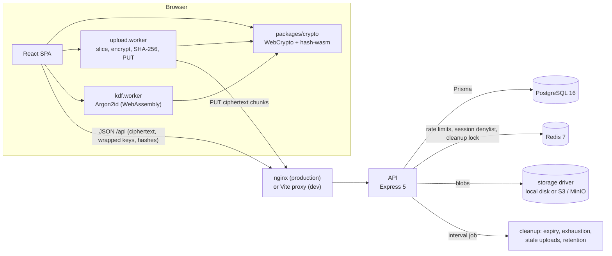
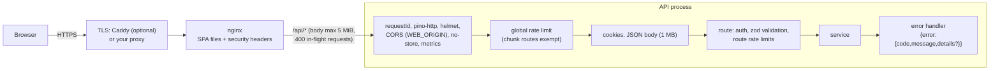
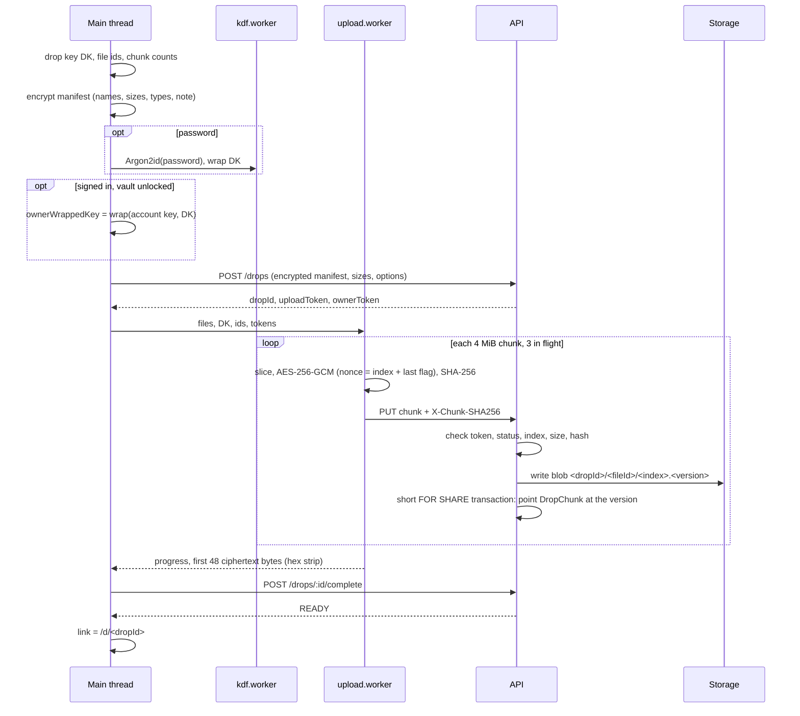
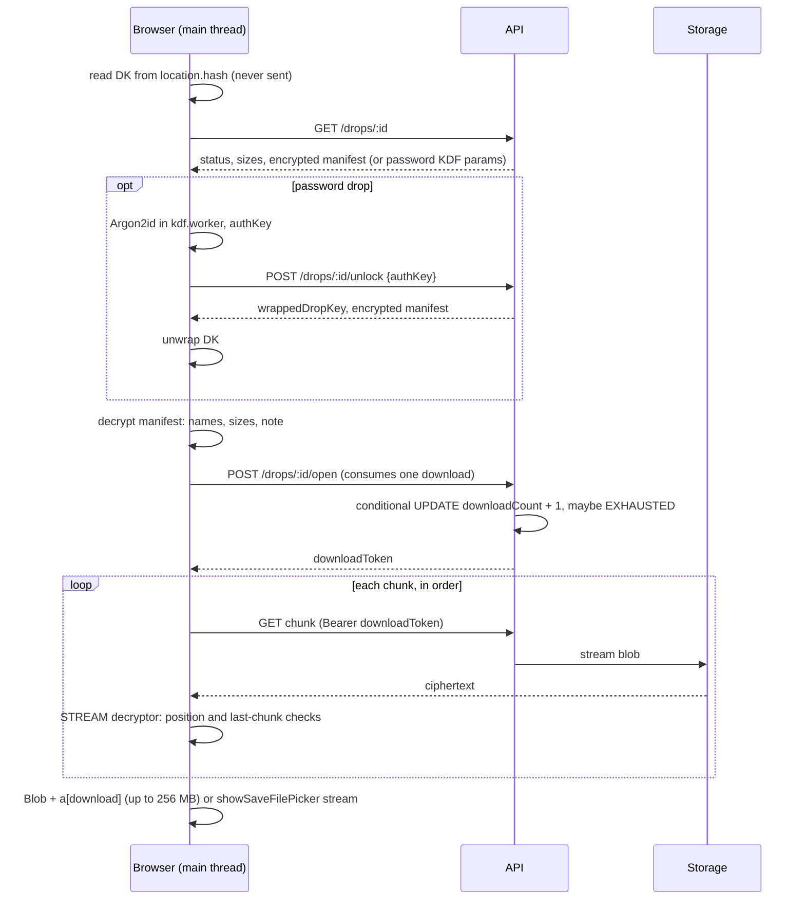
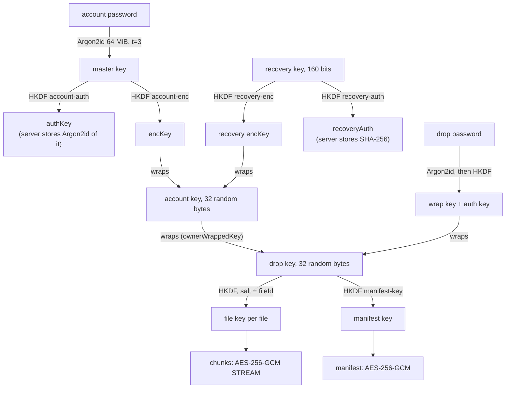
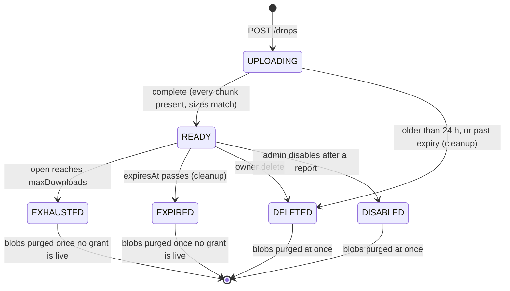

# Architecture

This page describes the components of CipherDrop, how data flows through them, and why the main design
decisions were made. The specification is [DESIGN.md](DESIGN.md) (its Decisions log records every deviation);
the threat model is [SECURITY.md](SECURITY.md).

## 1. Components



| Workspace | Role |
|---|---|
| `packages/crypto` | The whole cryptographic construction: STREAM chunk encryption, manifest, key wrapping, Argon2id with parameter bounds, account and recovery bundles, share links. Isomorphic: the same code runs in the browser, in Node tests, in the seed script and in the benchmarks. |
| `packages/shared` | zod schemas for every request and response, shared constants and limits. The API validates with them, the SPA validates responses with them, and the OpenAPI document is generated from them. |
| `apps/api` | Express 5 REST API: auth and sessions, drops and chunk transfer, admin, audit, cleanup job, OpenAPI, Prometheus metrics. It stores and returns opaque base64url strings and byte streams and never parses ciphertext. |
| `apps/web` | React 19 SPA (Vite, Tailwind 4, React Router 7, TanStack Query 5, Zustand 5). All encryption and decryption happens here. |

The server's job is to validate sizes, counts, tokens and quotas, enforce download limits and expiry, and keep
an audit trail, without the means to read what it stores.

## 2. Request path



Every route is registered through one helper (`createRouter` in `apps/api/src/lib/router.ts`) that adds the
Express route, its OpenAPI entry and its auth middleware together, which is how the OpenAPI document stays
complete (a test walks the router stack to prove it). Requests are logged with id, method, path without query,
IP prefix and status only.

In development the Vite dev server (port 5174) proxies `/api` to the API (port 4100), so the SPA is always
same-origin with the API. `vite preview` serves the production build with the production CSP, and the e2e suite
runs against it.

## 3. Upload pipeline



- Encryption and the PUTs run in a module Worker, so a large upload never blocks the UI. Failed PUTs (network,
  429, 5xx) are retried three times with backoff (0.5 s, 2 s, 8 s), honouring `Retry-After`.
- The server checks everything that does not need the body (token, status, file, index, hash format, declared
  length) before reading it, then buffers at most one chunk (4 MiB + 16 bytes).
- Each PUT writes a fresh blob version with no database connection held, then a short transaction re-checks that
  the drop is still uploading and points the chunk row at the new version. A delete, a disable or `complete`
  therefore never races with an in-flight write (review C-04 and C-R2-01).
- A reload mid-upload can resume: the browser keeps a record (no names, no secrets) in `sessionStorage`, asks the
  user to select the same files, re-encrypts the last received chunk of each file and compares its SHA-256 with
  `upload-status` before sending only the missing chunks.

## 4. Download pipeline



- A sink only produces a file on close: Blob parts are dropped on failure, and an aborted
  `FileSystemWritableFileStream` leaves the target untouched (Chromium writes to a temporary swap file until
  close). A tampered chunk (an `IntegrityError`) therefore blocks the save, and the UI says the file was modified.
- One grant serves every file of the drop and is reused while valid; the client never re-opens on its own,
  because opening consumes a download.
- Files above 256 MB need `showSaveFilePicker`. Without it the page refuses before calling `/open`, so a
  burn-after-read download is not wasted (review C-03).

## 5. Key hierarchy



- The link carries DK itself (43 base64url characters after `#`); a password drop's link carries nothing and DK is
  unwrapped after the password check.
- Changing the password re-wraps the same account key under a new `encKey`, so no drop is re-encrypted.
- The account key is unwrapped inside the kdf worker and handed to the page only as a non-extractable `CryptoKey`.

## 6. Drop lifecycle



- **Atomic consumption.** `/open` is one conditional `UPDATE ... WHERE status = 'READY' AND expiresAt > now() AND
  downloadCount < maxDownloads`; the same transaction sets EXHAUSTED when the count reaches the limit. With 10
  concurrent opens on a 1-download drop, exactly one succeeds (integration test).
- **Grants outlive the state change.** EXHAUSTED and EXPIRED drops keep serving chunks to a live grant, so a
  burn-after-read download that started can finish; their blobs are purged when no grant is live.
- **One purge path.** `purgeDropBlobs()` deletes storage first (idempotent), then sets `blobsDeletedAt` with a
  conditional update that releases the owner's quota exactly once, whichever of cleanup, owner delete or admin
  disable gets there first.
- **Cleanup** runs every `CLEANUP_INTERVAL_SEC` (60) under a Redis lock, so several API instances do not run it
  twice. It also prunes sessions and refresh tokens 7 days after expiry or revocation and audit events and closed
  reports after 90 days, and scrubs wrapped keys and verifiers from purged drops.
- **Quota.** A signed-in create locks the user row (`SELECT ... FOR UPDATE`) and counts used bytes plus the
  owner's in-progress uploads, so parallel creates cannot overshoot the quota.

## 7. Sessions

```mermaid
sequenceDiagram
  participant B as Browser
  participant A as API
  participant R as Redis
  B->>A: POST /auth/prelogin {email}
  A-->>B: KDF params (fake salt for unknown emails)
  B->>B: Argon2id in kdf.worker, authKey + encKey
  B->>A: POST /auth/login {email, authKey}
  A-->>B: access JWT (15 min, in memory) + cd_rt cookie (rotating)
  B->>A: GET /auth/vault, then unwrap the account key locally
  Note over B: vault unlocked; page reload locks it again
  B->>A: POST /auth/refresh (cookie), 30 s before expiry
  A->>A: mark token used, issue successor (one transaction)
  A-->>B: new JWT + new cookie
  Note over A: a used token presented again revokes the whole session
  B->>A: revoke a session, change password or recover
  A->>R: denylist session id for the access-token lifetime
  Note over A: auth middleware rejects that session's JWT immediately
```

- One `Session` row per login is the "token family"; each refresh token belongs to it and is single-use.
- Rotation is one transaction, so a lost response cannot look like token reuse and log the user out
  (review C-28).
- After a reload the session refreshes silently but the vault is locked: the user re-enters the password, which is
  checked locally by unwrapping the account key, with no request sent.

## 8. Design decisions

| Decision | Reason |
|---|---|
| Key in the URL fragment | Browsers never send the fragment to the server, so a link can carry the key while the server stays blind; password mode exists for links that travel through untrusted channels. |
| STREAM construction over 4 MiB chunks with the index and a last-chunk flag in the nonce | Files of several GB cannot be encrypted as one AES-GCM message in a browser. Per-chunk authentication alone would allow reordering and truncation; binding position and finality into the nonce makes both detectable without a separate MAC. |
| One key per file (HKDF with a random file id as salt) | Nonces are deterministic (chunk index), so uniqueness has to come from the key; a fresh key per file makes nonce reuse impossible for an honest client. |
| Argon2id in the browser, plus a server-side Argon2id of the result | The password never leaves the browser, and a stolen `authKeyHash` cannot be replayed as a login. |
| KDF parameter bounds enforced by the client | A malicious server could otherwise hand out weak parameters to make passwords cheap to guess. |
| An account key wrapped twice (password, recovery key) | Password change and recovery re-wrap one key instead of re-encrypting every drop; the dashboard decrypts names on any device. |
| All crypto in `packages/crypto`, isomorphic | One implementation to review; Node tests, a `node:crypto` re-implementation (conformance test) and known-answer vectors cover the exact code the browser runs. |
| Workers for Argon2id and upload | Argon2id at 64 MiB takes about 250 to 300 ms and encryption of large files is CPU-bound; workers keep the UI responsive. |
| Chunk PUTs buffered, chunk GETs streamed | Buffering at most 4 MiB + 16 bytes makes size and SHA-256 validation simple; downloads stream to keep memory flat. |
| Versioned blob keys (`<index>.<version>`) | A write never holds a database connection, and an in-flight write cannot resurrect a deleted drop (review C-R2-01). |
| Conditional `UPDATE` for downloads | Exactly-once consumption under concurrency without application locks. |
| Access token in memory, refresh token in a `SameSite=Strict` cookie scoped to `/api/auth` | Script cannot read the long-lived credential, and Bearer auth on all other routes removes CSRF. |
| Redis denylist of session ids | Revocation takes effect immediately instead of after the 15-minute access-token lifetime. |
| Same-origin SPA and API | The CSP stays `connect-src 'self'` and the cookie can be `SameSite=Strict`; a split deployment must route `/api` through the SPA's origin ([DEPLOYMENT.md](DEPLOYMENT.md) section 3). |
| No third-party scripts, fonts or CDNs | Every external origin would be code the threat model has to trust. |
| Local disk or S3 behind one storage interface | One contract test suite runs against both drivers (S3 against MinIO). |
